# Perf Clinic: Findings

Problems are ordered by impact on the user, highest first.

### 1. Huge images making the hero load slowly (LCP)
- **Symptom:** the header shows up fast, but the big hero banner takes a few seconds to appear, even on fast 4G.
- **How I found it:** Lighthouse in incognito with Fast 4G. LCP was 4.9 s (red). "Improve image delivery" said I could save 5,911 KiB, and "LCP request discovery" said the hero image had no priority. In the Network tab `hero.png` was by far the biggest file, then the 12 avatar PNGs.
- **Root cause:** `hero.png` was a 4.2 MB PNG. The avatars were about 160 KB each (about 1.9 MB total) but they are only shown at 48 px. Also, the hero `` had no `fetchpriority` and no `width`/`height`, and the avatars were not lazy loaded, so everything fought for the same bandwidth and fetching at the same time.
- **Fix:**
  - Converted the hero and all 12 avatars to WebP/avif but i choose WebP.
  - Gave `width` and `height` to the hero and avatar images, so the browser keeps the space before the image load and the prevent the layout shifting.
  - Avatars: `loading="lazy"` so they load only when needed (on demand), and `decoding="async"` so decoding does not block the main thread.
  - Hero: `fetchpriority="high"` so it loads first, and `decoding="async"`.
  - Added `height: auto` to `.hero-image` so the new `height` attribute does not stretch it.
  - Small code idea (not done): put the image path inside each object of `window.AGENTS` in `config.js`, so `renderAgents` does not build the path with `padStart`. It is cleaner code but the speed gain is almost zero.
- **Before / after:**

  | | Before | After |
  |---|---|---|
  | Hero | 4,271,977 bytes | 267,146 bytes (-94%) |
  | 12 avatars | about 1.9 MB | about 34 KB |
  | `assets/` folder | about 6.2 MB | 332 KB |
  | LCP (Lighthouse, Fast 4G) | 4.9 s | 1.1 s |
  | Lighthouse performance score | 77 | 93 |

  Before:

  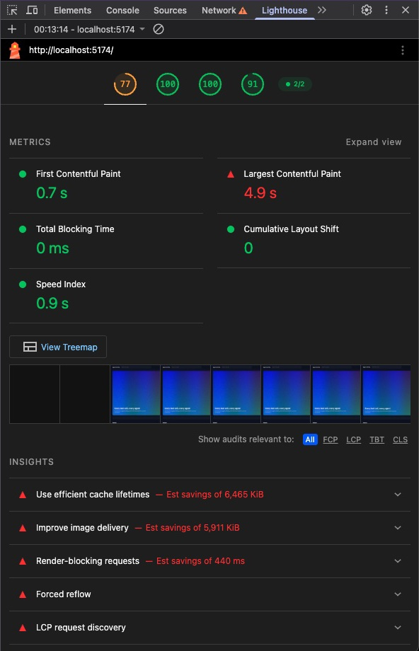

  After:

  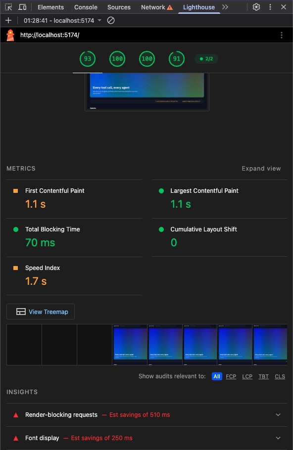

  Note: in the after run FCP (1.1 s vs 0.7 s) and Speed Index (1.7 s vs 0.9 s) came out higher. I think this is run-to-run noise, since nothing in this fix touches them.

### 2. Render-blocking CSS and JS in the head
- **Symptom:** the page shows nothing for a moment while the browser downloads a big CSS file and runs a script, even though the page only needs a small stylesheet.
- **How I found it:** Lighthouse "Render-blocking requests" insight (est. savings 510 ms). It listed three blocking requests. I also searched `theme.css` for the classes the page really uses (from `index.html` and `app.js`) and found none of them in it.
- **Root cause:** `theme.css` is a 327 KB utility-class file (7,160 selectors) and nothing on the page uses it, but it was in the `<head>` so the browser had to download and parse it before painting. `config.js` is a normal script in the `<head>` too, and it builds 100,000 events, so it stopped the HTML parsing until it finished.
- **Fix:**
  - Removed `theme.css` from the page and deleted the file.
  - Added `defer` to `config.js` and `app.js` (both in the head), so they download in parallel and run after the HTML is parsed, in order.
- **Before / after:**

  | Render-blocking requests | Before | After |
  |---|---|---|
  | `theme.css` | 319.4 KiB, 530 ms | removed |
  | `config.js` | 5.3 KiB, 250 ms | not blocking (deferred) |
  | `app.css` | 5.5 KiB, 250 ms | 5.5 KiB, 210 ms (still needed to paint) |
  | Total | 330.2 KiB, 1,030 ms | 5.5 KiB, 210 ms |
  | Lighthouse est. savings | 510 ms | 200 ms |

  Before:

  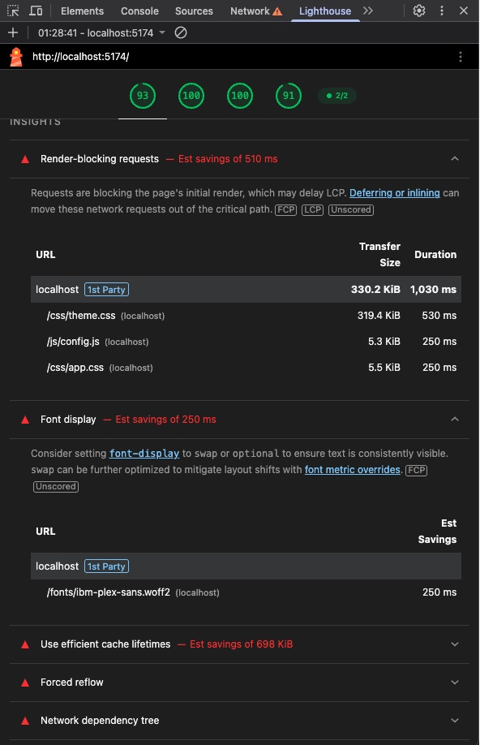

  After:

  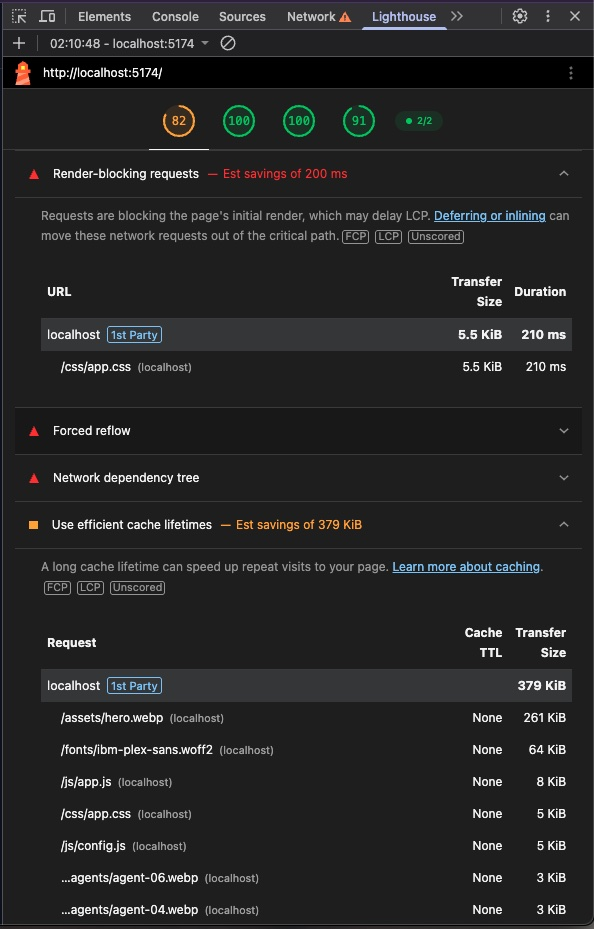

  Note: Lighthouse TBT went from 0 ms to 350 ms after this change, and the score went from 93 to 82 in one run. This is a side effect of `defer`.

### 3. font display Optimization
- **Symptom:** for a short moment the page text is invisible, because the browser waits for the custom font before it draws the words.
- **How I found it:** Lighthouse "Font display" insight, est. savings 300 ms, with `ibm-plex-sans.woff2` as the only item. Lighthouse also lists the web font under "Layout shift culprits".
- **Root cause:** the font is only mentioned inside `app.css`, so the browser finds out about it late, after the CSS is downloaded and parsed. The `@font-face` also had no `font-display`, so the default behaviour hides the text until the font arrives.
- **Fix:**
  - Added `font-display: swap` to the `@font-face`, so text shows right away in a fallback font and swaps to IBM Plex Sans when it is loaded.
  - Added `<link rel="preload" as="font" type="font/woff2" crossorigin>` for the font in `index.html`, so it starts downloading together with the CSS. `crossorigin` is needed for font preloads, otherwise the file is fetched twice.
- **Before / after:**

  | | Before | After |
  |---|---|---|
  | Lighthouse "Font display" est. savings | 300 ms (`ibm-plex-sans.woff2`) | insight gone |
  | CLS | 0 | 0 |

  Before:

  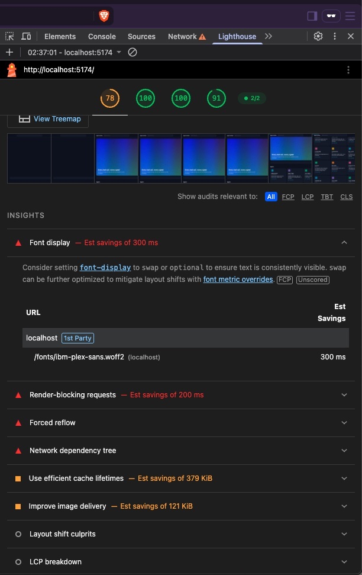

  After:

  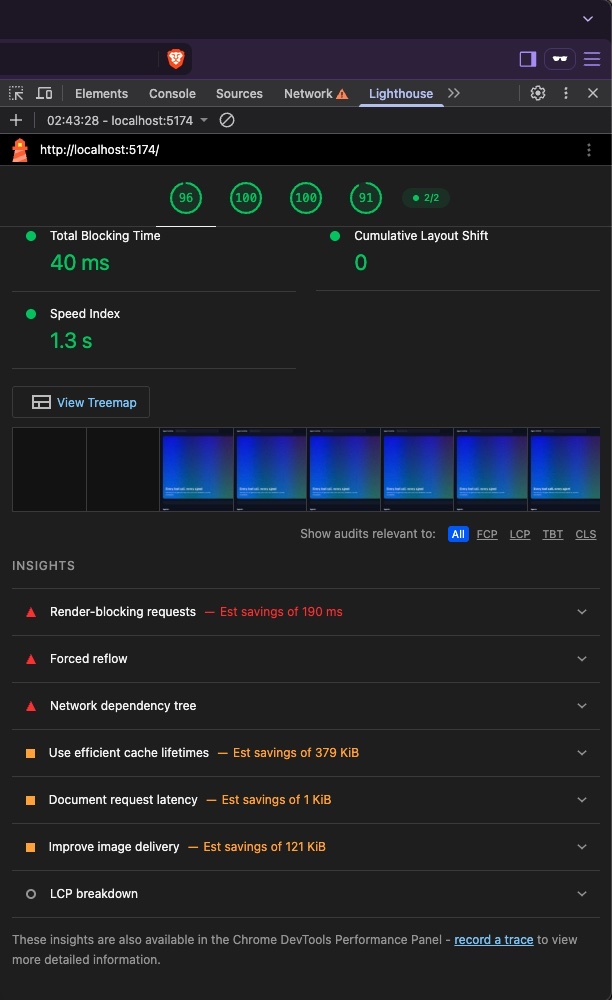

### 4. Search is slow and freezes the page
- **Symptom:** when I type in the search box the page freezes and the letters show late. The first load is also slow.
- **How I found it:** DevTools Performance panel. I recorded a page reload and also typing `billing`. Both show long red tasks with `renderResults` and `search` inside.
- **Root cause:** every search sorted all 100,000 events using `new Date(...)` inside the sort, and it turned every event into text again. This ran on load and on every key press, with no waiting between keys.
- **Fix:**
  - Sort the events only once, comparing the timestamp strings directly (no `Date`).
  - Build the search text only once and reuse it.
  - Wait 150 ms after the last key before searching (debounce).
- **Before / after:**

  | | Before | After |
  |---|---|---|
  | Typing `billing`: INP | 1,595 ms | 335 ms |
  | Typing `billing`: busy time in the selected range | 2,699 ms | 1,484 ms |
  | Typing `billing`: long tasks | 3 (several key presses each) | 2 (one per pause) |
  | Typing `billing`: Scripting / Rendering | not recorded | 258 ms / 307 ms |
  | Page load: LCP | 1.39 s | 0.78 s |
  | Page load: Scripting (recorded range) | 803 ms (0 to 1.56 s) | 182 ms (330 to 850 ms) |
  | Page load: Rendering (recorded range) | 180 ms | 151 ms |
  | Search run on load, `search("")` (Node test) | 688 ms | 0 ms (the 48 ms sort now happens once) |
  | One search for `billing` (Node test) | 65 ms | 9 ms (about 80 ms the first time only) |

  Page load, before and after:

  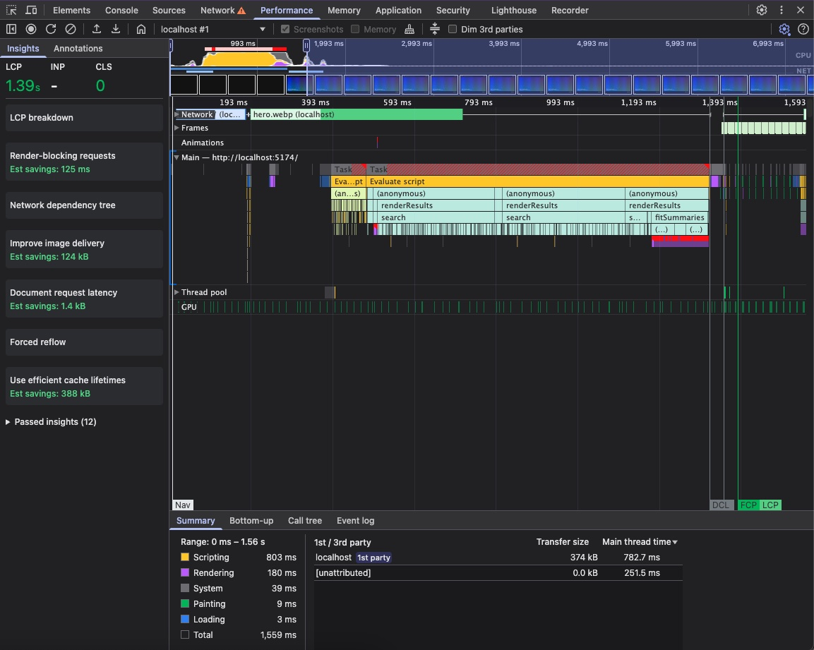
  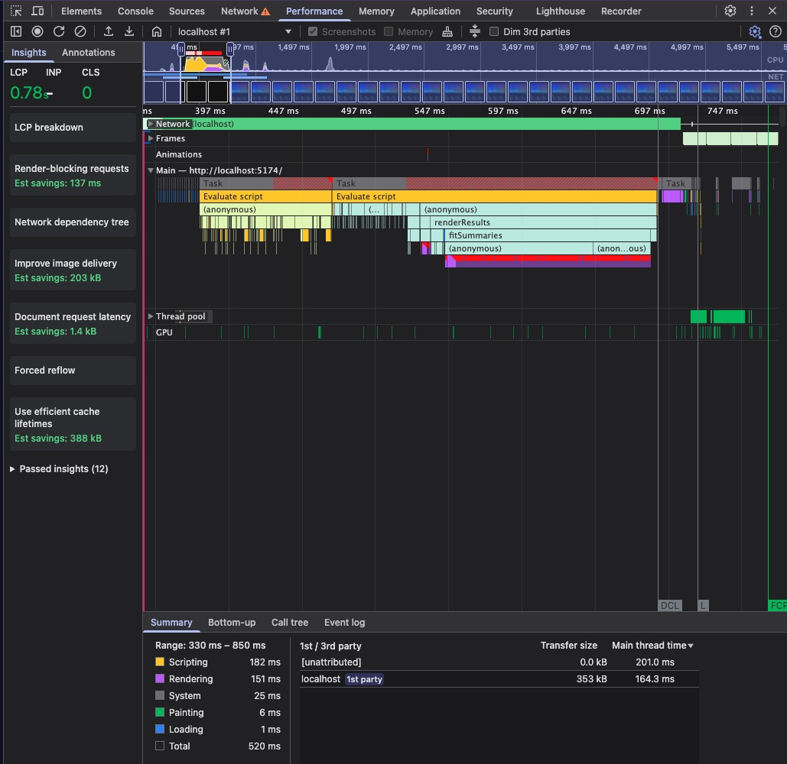

  Typing `billing`, before and after:

  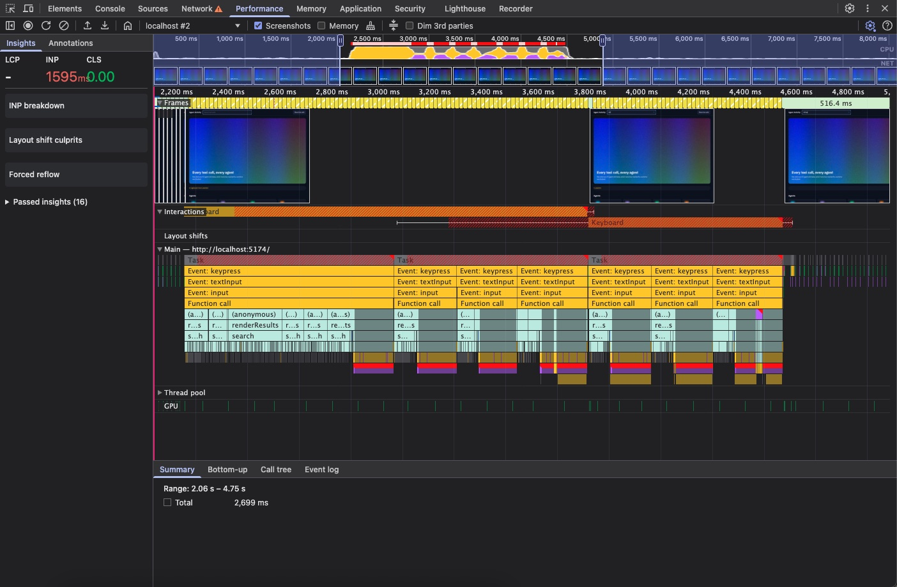
  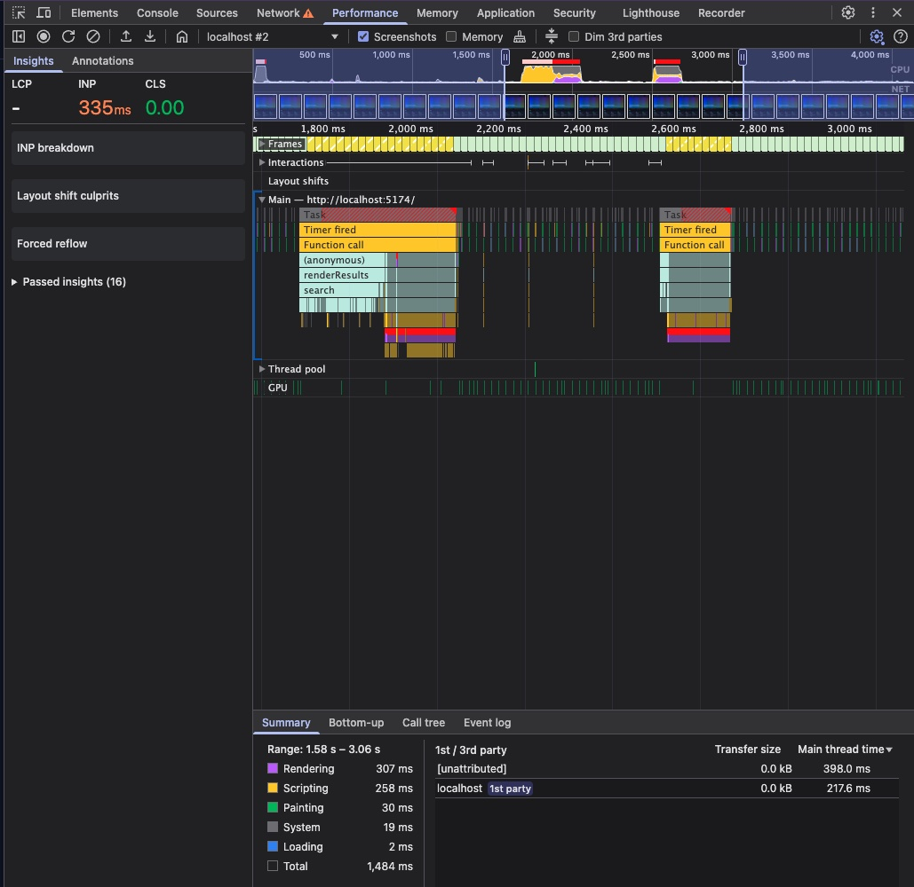

  Note: some red and purple blocks are still there after the fix. That is `fitSummaries` and the `localStorage` writes, which are not fixed yet.

### 5. Forced reflow when the page loads
- **Symptom:** the page spends extra time on layout when it loads and after every search, so the list shows up later than it should.
- **How I found it:** DevTools Performance panel, "Forced reflow" insight, on a page reload. It showed 128 ms total reflow time, caused by two places in `app.js`: line 57 (`card.offsetTop`) and line 122 (`cell.scrollWidth`). In the flame chart there are hundreds of tiny red Layout blocks under `fitSummaries`.
- **Root cause:** the code changes a style and then reads a size (`scrollWidth`, `offsetTop`) inside a loop. Each read makes the browser recalculate the layout right away. `fitSummaries` did this for each of the 200 rows, and `equalizeCardHeights` did it for each agent card (and ran again after every image load).
- **Fix:**
  - `fitSummaries`: first set the font size of all cells, then read all the widths together, then shrink only the cells that still don't fit. It repeats this at most 7 times (14px down to 11px), not once per cell.
  - `equalizeCardHeights`: removed the JavaScript. The grid now stretches the cards in a row to the same height by itself, and `min-height: 220px` on the card keeps the old minimum.
- **Before / after:**

  | | Before | After |
  |---|---|---|
  | Forced reflow, total | 128 ms | 35 ms |
  | Places that trigger it | 2 (`app.js:57`, `app.js:122`) | 1 (`app.js:108`) |
  | Rendering (selected range) | 128 ms | 44 ms |
  | Total in selected range | 188 ms | 75 ms |

  Before and after:

  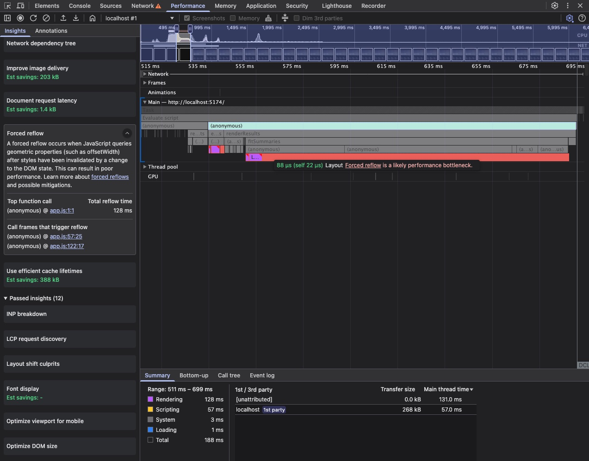
  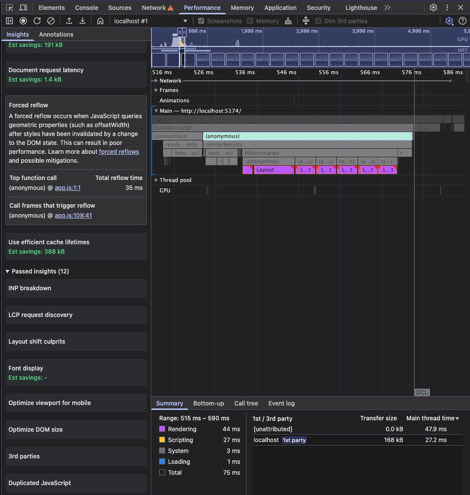

### 6. Scrolling the list is janky
- **Symptom:** scrolling the list stutters, and the highlighted row lags behind.
- **How I found it:** DevTools Performance panel, recording while scrolling. The Main row was full of long `onScroll` tasks, frames were mostly yellow, and there were hundreds of `background-color` animations.
- **Root cause:** `onScroll` ran on every scroll event. For each of the 200 rows it changed a class (write) and then read its position (read), then the next row did the same: write, read, write, read... This is layout thrashing: every read after a write makes the browser redo the layout, so one scroll event caused up to 200 layouts. It also searched all 100,000 events on every scroll. The row background transition kept restarting, so rows were repainted all the time.
- **Fix:**
  - Run the scroll work once per frame (`requestAnimationFrame`).
  - Fix the layout thrashing: read all row positions first, then do all the writes (read, read, read... then write, write, write...). Now the browser does only one layout per frame. Also only the rows that really change are touched.
  - Count calls per minute once and look it up.
  - CSS: removed the row background transition, and used `box-shadow` for the blue bar instead of border and padding.
- **Before / after:**

  | | Before | After |
  |---|---|---|
  | Long tasks while scrolling | back-to-back, about 55 to 60 ms each | none |
  | Frames | mostly yellow | mostly green |
  | `background-color` animations | hundreds | almost none |

  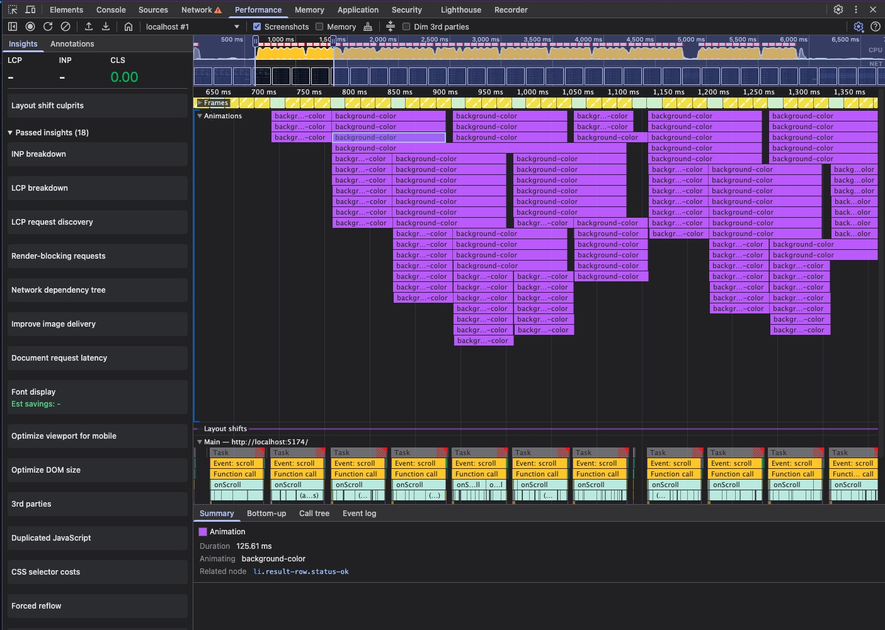
  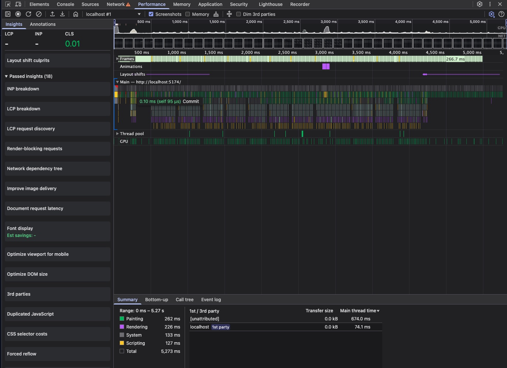
